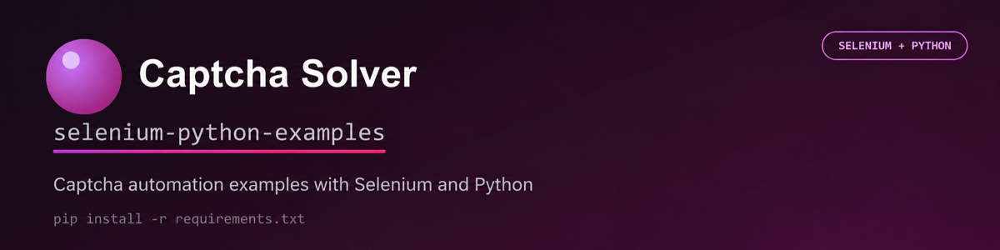

# Captcha solving examples with Python and SeleniumBase



Examples of solving popular captcha types with
[`captcha-solver-api`](https://pypi.org/project/captcha-solver-api/),
[Selenium](https://www.selenium.dev/), and
[`seleniumbase`](https://seleniumbase.io/).

Use the examples only on public demo pages or websites you own or are authorized to test.

> [!IMPORTANT]
> Every example creates a paid CAPTCHA task. Run it only with an API key you are authorized to use.
> A returned SDK solution does not by itself prove that the target page accepted the solution.

The browser examples show how to:

1. Open a page and collect captcha parameters.
2. Send a task to Captcha Solver.
3. Apply the solution in the browser.
4. Check that the page accepted the solution when it exposes a verification result, or confirm
   delivery to the page callback when it does not.

The image, coordinates, and captured Yandex challenge examples instead read test images from
`assets/`, submit them to the API, and print recognized text, coordinates, or the required number
of slider-arrow clicks. They do not open a browser.

## Install

Requirements:

- Python 3.10 or newer
- Google Chrome for browser-based examples
- A Captcha Solver API key with a positive balance

```bash
git clone https://github.com/captcha-solver-api/captcha-solver-selenium-python-examples.git
cd captcha-solver-selenium-python-examples
python -m venv .venv
```

On macOS and Linux:

```bash
source .venv/bin/activate
python -m pip install -r requirements.txt
cp .env.example .env
```

On Windows:

```powershell
.venv\Scripts\Activate.ps1
python -m pip install -r requirements.txt
Copy-Item .env.example .env
```

Set your API key in `.env`:

```dotenv
CAPTCHA_API_KEY=your_api_key
CAPTCHA_SOLVE_TIMEOUT=300
```

`CAPTCHA_SOLVE_TIMEOUT` controls how many seconds `CaptchaClient.solve()` waits while polling.
The examples default to 300 seconds when the variable is omitted. They load `.env` automatically;
keep that file private because it contains credentials and is ignored by Git.

## Run

Run commands from the repository root.

reCAPTCHA:

```bash
python examples/recaptcha/recaptcha_v2.py
python examples/recaptcha/recaptcha_v2_proxy.py
python examples/recaptcha/recaptcha_v2_callback.py
python examples/recaptcha/recaptcha_v2_callback_proxy.py
python examples/recaptcha/recaptcha_v2_enterprise.py
python examples/recaptcha/recaptcha_v3.py
python examples/recaptcha/recaptcha_v3_enterprise.py
```

Cloudflare:

```bash
python examples/cloudflare/cloudflare_turnstile.py
python examples/cloudflare/cloudflare_challenge_page.py
```

Tencent:

```bash
python examples/tencent/tencent.py
```

GeeTest:

```bash
python examples/geetest/geetest_v3.py
python examples/geetest/geetest_v4.py
```

Yandex SmartCaptcha:

```bash
python examples/yandex/yandex_smartcaptcha.py
python examples/yandex/yandex_smartcaptcha_image.py
python examples/yandex/yandex_smartcaptcha_kaleidoscope.py
```

Local image and coordinates tasks:

```bash
python examples/image/image_to_text.py
python examples/image/image_to_text_digits.py
python examples/image/image_to_text_math.py
python examples/coordinates/coordinates.py
```

Proxy examples additionally require the `PROXY_*` variables from `.env`.

## Examples

`Proxyless` means that the service solves without a user-supplied proxy. `Proxy` means that the
browser and task use the configured `PROXY_*` settings. `Not applicable` is used for image-based
tasks that do not browse a target page.

| Captcha | SDK task class | Proxy status | File |
|---|---|---|---|
| reCAPTCHA v2 | `RecaptchaV2TaskProxyless` | Proxyless | [`recaptcha_v2.py`](examples/recaptcha/recaptcha_v2.py) |
| reCAPTCHA v2 Enterprise | `RecaptchaV2EnterpriseTaskProxyless` | Proxyless | [`recaptcha_v2_enterprise.py`](examples/recaptcha/recaptcha_v2_enterprise.py) |
| reCAPTCHA v2 + proxy | `RecaptchaV2Task` | Proxy | [`recaptcha_v2_proxy.py`](examples/recaptcha/recaptcha_v2_proxy.py) |
| reCAPTCHA v2 callback | `RecaptchaV2TaskProxyless` | Proxyless | [`recaptcha_v2_callback.py`](examples/recaptcha/recaptcha_v2_callback.py) |
| reCAPTCHA v2 callback + proxy | `RecaptchaV2Task` | Proxy | [`recaptcha_v2_callback_proxy.py`](examples/recaptcha/recaptcha_v2_callback_proxy.py) |
| reCAPTCHA v3 | `RecaptchaV3TaskProxyless` | Proxyless | [`recaptcha_v3.py`](examples/recaptcha/recaptcha_v3.py) |
| reCAPTCHA v3 Enterprise | `RecaptchaV3TaskProxyless` | Proxyless | [`recaptcha_v3_enterprise.py`](examples/recaptcha/recaptcha_v3_enterprise.py) |
| Cloudflare Turnstile | `TurnstileTaskProxyless` | Proxyless | [`cloudflare_turnstile.py`](examples/cloudflare/cloudflare_turnstile.py) |
| Cloudflare Challenge | `TurnstileTaskProxyless` | Proxyless | [`cloudflare_challenge_page.py`](examples/cloudflare/cloudflare_challenge_page.py) |
| GeeTest v3 | `GeeTestTaskProxyless` | Proxyless | [`geetest_v3.py`](examples/geetest/geetest_v3.py) |
| GeeTest v4 | `GeeTestTaskProxyless` | Proxyless | [`geetest_v4.py`](examples/geetest/geetest_v4.py) |
| Tencent CAPTCHA | `TencentTaskProxyless` | Proxyless | [`tencent.py`](examples/tencent/tencent.py) |
| Yandex SmartCaptcha | `YandexSmartCaptchaTaskProxyless` | Proxyless | [`yandex_smartcaptcha.py`](examples/yandex/yandex_smartcaptcha.py) |
| Yandex SmartCaptcha image | `YandexSmartCaptchaImageTask` | Not applicable | [`yandex_smartcaptcha_image.py`](examples/yandex/yandex_smartcaptcha_image.py) |
| Yandex SmartCaptcha Kaleidoscope | `YandexSmartCaptchaKaleidoscopeTask` | Not applicable | [`yandex_smartcaptcha_kaleidoscope.py`](examples/yandex/yandex_smartcaptcha_kaleidoscope.py) |
| Image captcha, text | `ImageToTextTask` | Not applicable | [`image_to_text.py`](examples/image/image_to_text.py) |
| Image captcha, digits | `ImageToTextTask` | Not applicable | [`image_to_text_digits.py`](examples/image/image_to_text_digits.py) |
| Image captcha, math | `ImageToTextTask` | Not applicable | [`image_to_text_math.py`](examples/image/image_to_text_math.py) |
| Coordinates | `CoordinatesTask` | Not applicable | [`coordinates.py`](examples/coordinates/coordinates.py) |

## Target pages

The `.env.example` file contains official public demo URLs for reCAPTCHA v2 and Yandex
SmartCaptcha. URLs under `example.com/page_with_...` are intentionally non-working placeholders.
Replace them with pages you own or are authorized to test before running the matching examples.

| Variable | Used by |
|---|---|
| `RECAPTCHA_V2_TARGET_URL` | reCAPTCHA v2 proxyless and proxy examples |
| `RECAPTCHA_V2_CALLBACK_TARGET_URL` | reCAPTCHA v2 callback examples |
| `RECAPTCHA_V2_ENTERPRISE_TARGET_URL` | reCAPTCHA v2 Enterprise |
| `RECAPTCHA_V3_TARGET_URL` | reCAPTCHA v3 |
| `RECAPTCHA_V3_ENTERPRISE_TARGET_URL` | reCAPTCHA v3 Enterprise |
| `TURNSTILE_TARGET_URL` | Cloudflare Turnstile widget |
| `TURNSTILE_CHALLENGE_TARGET_URL` | Cloudflare Challenge page |
| `GEETEST_V3_TARGET_URL` | GeeTest v3 |
| `GEETEST_V4_TARGET_URL` | GeeTest v4 |
| `TENCENT_TARGET_URL` | Tencent CAPTCHA |
| `YANDEX_TARGET_URL` | Yandex SmartCaptcha browser example |

The callback reCAPTCHA v2 examples additionally use `RECAPTCHA_V2_CALLBACK_NAME` and
`RECAPTCHA_V2_CALLBACK_SUCCESS_SELECTOR`. Some examples accept `TARGET_URL` as a generic fallback.

> [!IMPORTANT]
> Changing only a URL does not adapt page-specific selectors, callbacks, initialization
> endpoints, solution fields, or acceptance checks. Review those details for the target page.

## SDK solution and page acceptance

`CaptchaClient.solve(task)` creates the task, polls it, and returns the `solution` object rather
than the complete transport response. The fields and the way they must be applied depend on the
CAPTCHA type and the target page.

> [!IMPORTANT]
> There is no universal way to submit a CAPTCHA solution. Before adapting an example, inspect the
> target page's widget initialization, hidden fields, callbacks, form submission, network requests,
> and success response. The examples implement only the flow used by their configured demo pages;
> users must adapt extraction, solution delivery, and acceptance checks for their own pages.

| CAPTCHA type | SDK solution | What the example does | Acceptance check |
|---|---|---|---|
| reCAPTCHA v2, including Enterprise and proxy variants | `gRecaptchaResponse` | Writes the token to the page response field or invokes the configured callback, then submits when required | Requires the configured page success state |
| reCAPTCHA v3, including Enterprise | `gRecaptchaResponse` | Delivers the token through the action or page integration used by that example | Requires the page's verification result |
| Cloudflare Turnstile widget | `token` | Writes `cf-turnstile-response` and submits the form | Requires the page success message |
| Cloudflare Challenge page | `token` | Invokes the callback captured from the page's Turnstile render options | Requires the page success message |
| GeeTest v3 | `challenge`, `validate`, `seccode` | Writes all three values to the matching form fields and submits | Requires a successful verification response |
| GeeTest v4 | `captcha_id`, `lot_number`, `pass_token`, `gen_time`, `captcha_output` | Returns all five values through the widget validation integration and submits | Requires a successful verification response |
| Tencent CAPTCHA | `ticket`, `randstr` | Delivers both values to the original page callback | Confirms callback delivery; server-side acceptance requires a page-specific check |
| Yandex SmartCaptcha | `token` | Writes `smart-token` and submits the form | Requires the official demo success response |
| Yandex SmartCaptcha image | `coordinates` | Prints ordered image-space click points | Not applicable; the user must click the original challenge and verify it |
| Yandex SmartCaptcha Kaleidoscope | click count | Prints the number of required slider-arrow clicks | Not applicable; the user must apply the clicks and verify the challenge |
| Image to text, digits, and math | `text` | Prints the recognized text, digits, or calculated result | Not applicable; the user must submit it to the source page and verify it |
| Coordinates | `coordinates` | Prints image-space click points | Not applicable; the user must scale and click them on the source challenge |

GeeTest v3 `challenge` values are dynamic and single-use. The v3 example requests a fresh pair
from the configured target's initialization endpoint before opening the widget. Adapt that
endpoint when using a different page.

Receiving a solution from the SDK proves only that the solver task completed. It does not prove
that the target accepted the response; rely on an explicit page or server result instead.

## Proxy

```dotenv
PROXY_TYPE=http
PROXY_ADDRESS=proxy.example.com
PROXY_PORT=8080
PROXY_LOGIN=
PROXY_PASSWORD=
```

The browser and API task use the same proxy.

## Quality checks

```bash
python -m pip install -r requirements-dev.txt
python -m pytest
python -m ruff check .
python -m ruff format --check .
```

The pytest suite includes unit tests for shared configuration helpers and browser regression tests
against local in-memory HTML. It does not visit external CAPTCHA pages, call the solver API, create
paid tasks, or use the API key from `.env`.

## Documentation and related projects

- [Captcha Solver API documentation](https://captcha-solver.com/en/docs/captcha-types)
- [Captcha Solver code examples](https://captcha-solver.com/en/docs/code-examples)
- [Captcha Solver Python SDK](https://github.com/captcha-solver-api/python-sdk)
- [Captcha Solver Python SDK on PyPI](https://pypi.org/project/captcha-solver-api/)
- [Captcha Solver Python examples](https://github.com/captcha-solver-api/python-examples)
- [Captcha Solver JavaScript examples](https://github.com/captcha-solver-api/javascript-examples)
- [Captcha Solver Puppeteer examples](https://github.com/captcha-solver-api/captcha-solver-puppeteer-javascript-examples)
- [Captcha Solver Playwright examples](https://github.com/captcha-solver-api/captcha-solver-playwright-javascript-examples)
- [Cloudflare Turnstile Puppeteer demo](https://github.com/captcha-solver-api/cloudflare-turnstile-puppeteer-demo)
- [Tencent CAPTCHA automation guide](https://github.com/captcha-solver-api/How-to-Automate-Tencent-CAPTCHA)

## Security

Report vulnerabilities privately as described in the [security policy](SECURITY.md). Never post
API keys, proxy credentials, cookies, or paid task results in a public issue.

## Troubleshooting

Run commands from the repository root. The scripts add that root to Python's import path and load
`.env` automatically, so no PowerShell environment-import command is required.

`Set ... in the environment or .env file` means that the required value is absent or empty.
Copy `.env.example` to `.env`, set `CAPTCHA_API_KEY`, and replace the matching `example.com`
target before retrying.

`CaptchaTimeoutError` means the task was not solved within `CAPTCHA_SOLVE_TIMEOUT`; it may still
finish later. `ERROR_CAPTCHA_UNSOLVABLE` is a solver result rather than a Selenium setup error and
can be retried with fresh dynamic parameters where the CAPTCHA type requires them.

## License

This project is licensed under the [MIT License](LICENSE.md).
